# Atomium 架构设计说明

状态：**已确认**（2026-11-27 · 代码基线为 `main` 的 `a4ae5f4`，已实现协议 v1.2）  
文档分工：[product-spec.md](product-spec.md) 记录产品决策与红线 · **本文定义系统分层实现与安全验收条件** · [protocol-v2.md](protocol-v2.md) 定义线上协议契约  
背景参考：[当前挑战与可能方向](project-challenges-and-directions.md) · [开发状态](../DEVELOPMENT-STATUS.md) · [S1 原型报告](prototypes/s1-native-gui-box.md)

---

## 1. 设计背景与核心架构收敛

在完成 M0–M4 内核建设、PR #4 安全加固（协议 v1.2）以及 S1 原生跨用户窗口原型实测（`no-go`）后，项目围绕真实落地面临四个核心约束：

1. **macOS 虚拟化配额、资源与许可边界**：Apple 在内核 Hypervisor 层限制单机同时最多运行 **2 台** macOS 虚拟机（`hv_apple_isa_vm_quota`），单实例需占用 4–8GB 内存与 30–50GB 磁盘；同时 macOS Tahoe 软件许可（§2B(iii)）要求在自有或受控 Apple 硬件上按软件开发、开发测试、macOS Server 或个人非商用等具体适用条款判断合规性，不能无差别作为一般办公或第三方托管虚拟桌面铺开。
2. **开箱网络受阻与策略归属未收口**：现有 `atomium-gateway` 仅支持转发至调用方传入的上游代理，无上游时一律返回 `502` 阻断；出网白名单与上游地址仍由调用方请求携带，尚未沉淀为守护进程托管、独立于宿主机系统代理的专属路由层。
3. **沙箱隔离与宿主协作的张力**：完全封死的沙箱无法完成真实开发与桌面协作（如 OAuth 网页授权、Git/SSH 签名、受控调用宿主机工具链）；而开放任意宿主命令执行又会令隔离彻底失效。
4. **双套桌面 UI 的维护负担**：若同时维护 macOS SwiftUI 主面板（含 UniFFI 胶水层）与 Windows/Linux Tauri 面板，前端与状态同步工作量将成倍膨胀。

围绕“**先打穿研发 CLI 工作区闭环，再扩展轻量 Linux 容器与桌面级能力**”的路线，系统架构做出四项核心收敛：

- **分阶段、多档位隔离模型（L1 → L3 → L2）**：
  - **Phase 1 聚焦免 `sudo` 的 L1 CLI Box**（macOS Seatbelt + 用户态独立 `LaunchAgent`），零提权摩擦跑通真实仓库开发、受控联网与审阅导出闭环；
  - **Phase 2 引入 L3 轻量 Linux 容器 Box**（以轻量 Linux VM 承载 OCI Linux 容器），不受 2 台 macOS VM 内核配额限制，作为 Linux 开发任务、通用 Agent 与高并发运行的扩展后端；将触碰宿主机的动作收敛为跨门户通道的**受控宿主机能力插件（Host Capability Plugins）**；
  - **保留 L2 macOS VM Box 作为可选高阶档位**（≤2 台，按许可适用场景启用），专门承接仅提供 macOS `.app` 的闭源客户端及原生多窗口 Computer Use 闭环。
- **独立于宿主系统的沙箱专用链式网关**：在 `atomium-gateway` 内实现守护进程托管的 `OutboundChain`（防 DNS Rebinding 受控直连、HTTP CONNECT / SOCKS5 单跳与多跳代理链、故障禁止静默降级直连），并优先提供**锁死固定上游源站的本地反向代理凭据代填口**。
- **控制面与门户面物理分离**：管理通道（`atomiumd.sock`）与每会话专属门户通道（`portal.sock` / `virtio-vsock`）物理隔离；门户身份由服务端按连接句柄静态绑定，严禁沙箱自批，永久不提供图灵完备的 `host.exec`。
- **工程栈统一瘦身**：核心控制面与策略裁决 100% Rust；全平台桌面主面板统一采用 **Tauri v2 + React**（[apps/desktop](../apps/desktop/package.json)），放弃单独重写 SwiftUI 主界面与 UniFFI UI 绑定；Swift 仅用于在 `native-helpers/` 下编写职责单一的薄原生辅助进程。

---

## 2. 总体分层架构与信任边界

```mermaid
flowchart TB
    subgraph Clients["可信控制端 (Control Plane Clients)"]
        CLI["atomium-cli (终端工作流与管理)"]
        Desktop["apps/desktop (Tauri v2 + React 全平台可信控制面板)"]
        Mobile["apps/mobile (远程签名审批控制端 · 后期)"]
    end

    subgraph HostTrusted["宿主机可信控制域 (atomiumd · Rust)"]
        AdminSock["控制面 Socket: atomiumd.sock (0600 + 对端签名校验)"]
        Engine["会话与后端生命周期引擎 (Lease · RuntimeBackend · PTY)"]
        Vault["EncryptedVault (AES-256-GCM · Singleflight 令牌刷新)"]
        Broker["WorkspaceBroker (工作副本 · 冻结 · 基线复核 · 恢复导出)"]
        PolicyBus["门户策略与脱敏审计总线 (Schema · Grant · PresenceProof)"]
    end

    subgraph GatewayLayer["沙箱专用链式网关 (atomium-gateway · 独立于宿主系统代理)"]
        Ingress["入向层: HTTP/CONNECT · SOCKS5h · 固定源站 BaseURL 反代"]
        Chain["出向链式路由 (OutboundChain): Direct(固定校验IP+SNI) · HTTP/SOCKS5 链"]
        Ingress --> Chain
    end

    subgraph Plugins["受控宿主机能力插件 (Out-of-Process 最小权限 Helpers)"]
        DevPlugin["开发与文件插件: fs.review · fs.pick · url.open · ssh.sign · xcode_build"]
        McpPlugin["生产力 MCP 插件: 日历 · 备忘录 · 邮件草稿 · 独立浏览器后端"]
        GuiPlugin["单窗口 Computer-Use 插件 (Swift): ScreenCaptureKit + AX + 高亮边框"]
    end

    subgraph Sandboxes["隔离执行域 (RuntimeBackend 多档位)"]
        PortalChan["每会话专属门户通道: runs/<id>/portal.sock (L1) / virtio-vsock (L3, L2)"]
        L1["L1 CLI Box (Phase 1 主力): macOS Seatbelt + LaunchAgent + PTY"]
        L3["L3 Linux 容器 Box (Phase 2 扩展): 轻量 Linux VM + OCI 容器 + VirtioFS"]
        L2["L2 macOS VM Box (高阶兜底 ≤2台): Virtualization.framework"]
    end

    CLI & Desktop --> AdminSock
    Mobile -. "Noise E2EE 中继 (后期)" .-> AdminSock
    AdminSock --> Engine
    Engine --> Vault & Broker & PolicyBus
    Engine --> Ingress

    L1 & L3 & L2 -- "唯一出网口 (Loopback / 用户态网卡)" --> Ingress
    L1 & L3 & L2 -- "服务端静态绑定会话身份" --> PortalChan
    PortalChan --> PolicyBus
    PolicyBus --> DevPlugin & McpPlugin & GuiPlugin
    Chain --> Internet(("目标公网服务 / 托管代理链"))
```



### 2.1 仓库模块职责映射

| 模块路径 | 语言 | 架构职责 | 当前状态与演进动作 |
| --- | --- | --- | --- |
| `crates/atomium-protocol` | Rust (`ts-rs`) | 跨层唯一协议真相源，生成 TS 绑定 | v1.2 已落地；按兼容演进规则增量扩展网关策略、会话与门户类型 |
| `crates/atomium-core` | Rust | SQLite WAL 租约、事件游标、Vault、WorkspaceBroker | v1.2 已成熟；补充 OAuth 单飞刷新协调与每会话 APFS/CoW 工作副本 |
| `crates/atomium-gateway` | Rust | 独占认证代理、HTTP 防走私检查、在途连接瞬时撤销 | 升级为**防重绑定直连 + 多跳代理链 + 固定源站 Base URL 反代** |
| `crates/atomium-runtime` | Rust | `RuntimeBackend` 抽象、Seatbelt 渲染与边界探针 | 从仅含 `name/probe` 扩展为实际启动/停止/I/O 生命周期接口；二期接 L3 |
| `crates/atomiumd` | Rust | 守护进程：控制面 RPC、运行编排、精确凭据脱敏、导出恢复 | 先完成单文件按域模块化拆分，再接入托管路由策略、PTY 与每会话门户 |
| `crates/atomium-cli` | Rust | 瘦客户端 CLI、强探针自检 `doctor`、开发工作流入口 | 新增代理链管理、LaunchAgent 安装及一站式开发会话命令 |
| `apps/desktop` | Tauri v2 + React | **全平台唯一桌面可信控制面板** | 承接会话监控、候选 diff 审阅、代理链配置、授权裁决与审计时间线 |
| `native-helpers/*` | Swift 6 | 极薄 macOS 原生执行器（无策略裁决权） | 按需提供 Linux 容器桥接、Touch ID 验证、单窗口采集与高亮边框插件 |

### 2.2 Tauri 主面板、外部浏览器与 Swift Helper 的权限边界

- **Tauri WebView 仅限控制面**：`apps/desktop` 在不同系统上使用各自原生 WebView（macOS 为 `WKWebView`、Windows 为 `WebView2`、Linux 为 `WebKitGTK`）。该进程只渲染本地打包的可信控制面前端，**严禁用于加载不可信外部网页，也不兼任 Agent 浏览器自动化的运行时**。
- **AI 浏览与 CDP 自动化独立隔离**：依赖 Chromium / CDP 或外部网页交互的能力，必须在隔离环境内部或独立的受限浏览器进程中运行，只具备浏览器自身权限，无权触碰 `atomiumd.sock`。
- **Swift Helper 只做受控动作执行**：`native-helpers/` 中的 Swift 进程只接收 `atomiumd` 校验通过后的明确指令并回传结构化结果；所有权限判断、配额检查与审计落盘统一留在 Rust 控制面。

---

## 3. 隔离运行时与 Computer Use 兼容设计

### 3.1 三档隔离运行时的定位、成本与许可边界

放弃 S1 已证伪的跨 UID 原生窗口方案（`L1-GUI`），也不采用系统侵入重且网络裸奔的“后台图形用户 VNC 转发”，执行后端明确划分为三档：

| 维度 | L1 CLI Seatbelt Box（Phase 1 主力） | L3 轻量 Linux 容器 Box（Phase 2 扩展） | L2 macOS VM Box（可选高阶档位） |
| --- | --- | --- | --- |
| **底层机制** | `sandbox-exec` `(deny default)` + 独立 `HOME/TMPDIR` + 用户态 `LaunchAgent` | 以轻量 Linux VM（`Containerization` / `Virtualization.framework`）承载 OCI Linux 容器 | `Virtualization.framework` macOS Guest + APFS 克隆 |
| **资源成本** | 毫秒级启动；无虚拟化常驻内存与镜像开销 | 亚秒级启动；**每容器运行独立轻量 Linux VM，仍有虚拟化内存与内核开销**（非共享 macOS 内核） | 秒级启动；单台约 4–8GB 内存、30–50GB 磁盘 |
| **技术配额限制** | 无并发实例硬上限；免 `sudo` 开箱即用 | **不受 2 台 macOS VM 内核配额限制**，并发仅受机器物理内存与 CPU 约束 | **内核硬限同时最多 2 台**（超出返回 `VZErrorVirtualMachineLimitExceeded`） |
| **许可适用边界** | 无虚拟化许可附加限制 | Linux 内核与 Apache-2.0 组件，无 macOS Guest 许可限制 | 须按 **macOS Tahoe SLA §2B(iii)** 逐场景核对：自有/受控 Mac 上的软件开发与开发测试、macOS Server、个人非商用各有明确条件；一般办公或向第三方托管共享不可默认视作允许 |
| **网络与门户通道** | SBPL 仅放行本机专属网关端口；门户走每会话 `portal.sock` | 虚拟网卡汇入宿主机网关；门户走 `virtio-vsock` | 用户态虚拟网卡汇入宿主机网关；门户走 `virtio-vsock` |
| **核心适用场景** | 日常研发 CLI Agent（Claude Code、Codex CLI、Gemini CLI、agy） | Linux 开发与构建任务、不可信仓库依赖安装、多会话高并发运行 | 仅提供 macOS `.app` 的闭源客户端、重度原生多窗口 Computer Use 隔离 |

### 3.2 L1 Seatbelt 弃用风险管控与 `RuntimeBackend` 生命周期演进

1. **锁定系统版本与启动前强探针（Fail-Closed）**
   - Apple 将 `sandbox-exec` 与自定义 SBPL 视为已弃用的内部实现细节，行为可能随 macOS 大版本变化。
   - L1 运行时在能力报告中记录 `os_version`、`os_build` 和 `sbpl_template_digest`。守护进程按 OS build、模板摘要和后端版本缓存探针，缓存有效期为 24 小时。生产运行启动前须确认七项必选探针通过，并验证本次渲染的策略可以装载。任一必选探针或装载预检未通过时，守护进程在申请租约、创建运行目录和写入运行记录前返回 `-32003`。
2. **`RuntimeBackend` 生命周期接口实心化**
   - P1.0 后，[`RuntimeBackend`](../crates/atomium-runtime/src/backend.rs) 负责环境准备、运行命令构造、管道进程启动、进程组终止与运行目录清理。`atomiumd` 负责协调凭据、工作区租约、出网、状态持久化和事件。
   - PR 1.1a 将本次策略的装载预检与正式启动分开。后端在私有临时夹具中验证策略，守护进程在预检后协调熔断锁存、待启动登记和正式进程启动。

### 3.3 Computer Use（桌面视觉与键鼠操控）双轨保留方案

针对 Codex 桌面版等应用在 macOS 上更成熟的原生 Computer Use 能力（基于 `ScreenCaptureKit` 单窗口抓帧 + `AXUIElement` 辅助功能树 + 后台并行虚拟光标），采用双轨承接：

1. **轨道 A（容器 / CLI Agent 经宿主机插件操作指定单窗口）**
   - 容器或 L1 内的 Agent 通过 MCP / 门户请求调用宿主机侧的 `macos-window-plugin`（Swift Helper）。
   - **强制边界**：仅允许通过 `ScreenCaptureKit` 单窗口过滤器采集用户显式绑定的单个窗口（不截全屏与系统通知）；优先使用 `AXUIElement` 后台语义操作；在 Rust 控制面硬编码禁止绑定 `Terminal`、`iTerm2`、`System Settings`、`Keychain Access` 及 Atomium 自身窗口；被控窗口常驻可信高亮边框，支持全局快捷键触发 `daemon.panic` 瞬断。
2. **轨道 B（L2 Mac VM 内部原生闭环）**
   - 需要完整使用闭源 Codex macOS 桌面版内置多窗口 Computer Use 时，将其与目标软件一同置于 L2 Mac VM 内运行，100% 保留原生体验，同时由硬件虚拟化阻断对宿主机桌面的任何访问。

### 3.4 L1 隐私防护口径的诚实分级

| 防护项 | v1.2 当前实现（同 UID Seatbelt） | Phase 1 补齐目标（LaunchAgent + SBPL 增强） | L3 Linux 容器 / L2 VM |
| --- | --- | --- | --- |
| 宿主私有文件与 `~/.ssh` | **已强制**（`(deny default)` 仅挂载 Broker 工作区副本） | **已强制**（保持免 `sudo` 开发工具链只读兼容） | **虚拟机边界隔离**（仅见授权挂载卷） |
| 宿主 Keychain | **已强制**（默认阻断 `securityd` 与 Keychain 目录） | **已强制** | **独立环境** |
| 宿主剪贴板 | **已强制**（`(deny default)` 未放行 pasteboard Mach 服务） | **已强制** + 纳入 `doctor` 自动化回归探针 | **独立环境**（经 Portal 桥接） |
| 终端 TCC 权限继承 | **未切断**（从终端直接启动 `atomiumd` 会继承 `responsible_pid`） | **已强制**（`atomiumd` 以独立用户态 `LaunchAgent` 运行） | **独立环境** |
| 主机名、硬件 UUID/序列号 | `sysctl` 已黑名单拦截；IOKit 属性尚未显式拦截 | **已强制**（补齐 `iokit-get-properties` 拒绝规则并入 `doctor`） | **独立虚拟身份** |
| 宿主系统用户名（UID） | **本机可见**（共享宿主 UID） | **本机可见**（如实标注；跨 UID 需求由 L3 容器承接） | **完全独立** |

---

## 4. 沙箱专用链式网关设计（`atomium-gateway` v2）

网关完全独立于宿主机系统代理（`SystemConfiguration`）运行，由守护进程统一持有出网策略与代理凭据。

### 4.1 入向端口模型与 Base URL 反代的三项独立验证

每次会话按需在 `127.0.0.1` 分配独占监听端口并签发一次性令牌：

1. **HTTP / `CONNECT` 策略代理口（保留 §7.1 一致性边界）**
   - 保持 keep-alive 逐请求鉴权、32KiB 头部上限、防 `Content-Length` + `chunked` 走私检查与 `shutdown_rx` 瞬时掐断。
   - **透明性边界保留**：普通 `CONNECT` 隧道只能在建连前核对目标域名、端口与路由策略；上游或目标握手建立后，隧道内部 TLS 字节流对网关不透明，**不能在普通 `CONNECT` 隧道上直接改写内部认证头**。
2. **轻量 `SOCKS5h` 策略入向口（按需启用）**
   - 强制要求 `ATYP = 0x03 (DOMAINNAME)` 提交目标域名（拒绝客户端本地解析后传裸 IP 绕过白名单），共享同一套域名策略与撤销机制。
3. **固定源站 Base URL 本地反向代理口（优先实现的免根证书注入模式）**
   - 沙箱内仅注入指向 `http://127.0.0.1:<cred_port>/<session_cap>` 的本地端点与受限占位凭据；网关校验会话能力后，在宿主内存中从 `EncryptedVault` 读取真实凭据写入上游 HTTPS 请求头。
   - **防凭据外带硬约束（Anti-Exfiltration）**：
     - 每个反代实例在服务端**静态绑定唯一目标上游 Origin（固定 Scheme + Host + Port）**，忽略并覆盖客户端传入的 `Host` 头或绝对 URI 目标；
     - 严格规范化请求路径，拒绝路径穿越或非法头部注入；
     - **严禁自动跟随上游 `3xx` 重定向转发任何真实凭据头**——验证修改 `Host`、篡改路径、切换上游地址或构造跨域重定向均无法将真实凭据带往其他目的地。
   - **三项分立验收要求（禁止混同证明）**：
     1. **客户端网关兼容性**：验证目标客户端支持自定义 Base URL、请求体格式、流式 SSE/chunked 响应及错误透传；
     2. **真凭据不进 Box**：验证沙箱环境、进程参数与文件系统中仅存在一次性网关会话令牌，搜不到真实供应商凭据；
     3. **个人订阅 OAuth 与 API Key 分别实测**：**API Key 反代跑通，绝不能作为个人订阅（如 `claude.ai` 或 ChatGPT 个人 OAuth 登录态）已接通的证据**。每种客户端 × 认证模式（API Key vs 个人 OAuth 订阅 vs 受限文件投影）必须单独验证上游接口、刷新机制与实际计费归属后，才可在应用画像中标为 `supported`。

### 4.2 同订阅并发与工作区并发的双锁分离

当前 `handle_runs_start` 同时依赖 `profile:<id>:oauth` 独占租约与 `workspace:<id>` 独占租约。解锁安全并发需分别处理两把锁：

- **凭据共享使用与 Singleflight 单飞刷新锁**：
  - 采用刷新令牌轮换（Refresh Token Rotation, RFC 9700）的供应商在刷新后会立即作废旧 `refresh_token`，并发刷新会导致冲突甚至触发整族令牌撤销。
  - 因此在宿主集中注入模式下，**不能简单将 OAuth 独占锁改为无保护共享锁**：多个会话可共享“当前有效访问令牌”的使用权，但守护进程内必须对同一 `profile_id` 维护 **Singleflight 互斥刷新锁**——当多个并发请求同时遇到令牌即将过期或 `401` 时，仅发起一次上游刷新，校验返回身份一致性与快照版本递增后原子更新 Vault，其余等待请求直接复用新令牌。对于仍使用 `IsolatedFile` 投影模式的客户端，继续维持 `profile:<id>:oauth` 独占租约。
- **工作区写入隔离**：
  - 同一 Broker 工作区在单副本模式下维持单写入者独占租约；Phase 2 多 Agent 并行实现时，为每个实现者会话分配独立的 APFS `clonefile` 写时复制工作副本，各自冻结候选后再经 Broker 基线冲突检测（`baseline_conflict`）审阅合并。

### 4.3 出向链式路由引擎（`OutboundChain`）与连接层防重绑定

```text
enum OutboundMode {
  Direct,                                // 受控直连（解析校验后固定 IP 连接 + 原始域名 TLS SNI）
  Chain { hops: Vec<ProxyHopSpec> },     // 单跳或多跳串联代理链 [Hop1 -> Hop2 -> ... -> Target]
}
```

**四个硬性连接与验收约束**：
1. **直连防 DNS Rebinding 覆盖实际建连点**：走 `Direct` 模式时，网关解析目标域名得到候选地址列表，逐一校验 IPv4/IPv6 非公网规则（拦截回环、私网、链路本地 `169.254.0.0/16`、CGNAT 等）；**底层 TCP 直接连接已通过校验的 `SocketAddr`**，严禁校验后把域名重新交给系统建连函数二次解析。在本地反代等由网关发起 TLS 的场景下，**显式保留原始目标域名用于 TLS SNI 与服务端证书主机名验证**；任何连接重试或备用地址回退都必须经过完全相同的地址校验。
2. **代理链故障严禁隐式回退直连**：当会话绑定的路由为 `Chain` 时，若任意一跳代理不可达、鉴权失败或握手超时，网关必须立即按 Fail-Closed 返回 `502` 并记录审计事件，**绝不允许静默降级为 `Direct` 直连而暴露宿主机真实网络出口**。
3. **远端代理解析责任边界如实标注**：当使用 `SOCKS5h` 或上游 `HTTP CONNECT` 将域名交由远端代理解析时，本地网关负责强制执行域名白名单与端口策略，并在审计与文档中明确注明：最终目标 IP 由远端代理解析，本地 DNS 检查不证明远端实际连接的物理 IP。
4. **出网策略收归守护进程托管**：代理跳点凭据存入 `EncryptedVault`，出网白名单与路由绑定由控制面配置并关联至 `Profile` / `Box`，逐步废弃在启动会话请求中由调用方直接传入原始 `upstream_proxy_addr`。

---

## 5. 受控宿主机插件体系（Host Capability Plugins）

### 5.1 双通道物理隔离与五项必测安全条件

由于 Phase 1 的 L1 免 `sudo` 与宿主运行在同一系统 UID 下，`atomiumd.sock` 的文件权限 `0600` 与 `getpeereid()` 均无法单独区分“宿主机可信面板”与“L1 沙箱内的 Agent 进程”。因此，双 Socket 架构必须同时通过 Seatbelt 路径隔离与服务端句柄绑定来强制执行，并将以下 **5 条列为门户上线前的自动化必测条件**：

1. **沙箱直连控制面被拒**：守护进程发布控制 socket 后，在 L1 Seatbelt 内尝试连接其配置路径和规范化路径，并按需补测 `/var` 或 `/tmp` 别名。每条路径先通过宿主侧连接确认可达，沙箱侧须返回 `EPERM` 或 `EACCES`，结果以 `target = "control_socket"` 留证。启动请求等待该轮探针，探针期间只读控制面仍可用。离线 `atomium doctor --emit-evidence <dir>` 只连接自建的金丝雀 listener，证据标为 `target = "canary"`。
2. **最小门户可见性**：L1 进程只能看到并连接守护进程放入其私有运行目录的专属门户入口 `runs_dir/<session_id>/portal.sock`（L3/L2 对应各自独立的 `virtio-vsock` 连接实例）。
3. **服务端静态绑定会话身份**：守护进程在对应会话的专属 `portal.sock` listener 上收到连接时，直接将该连接绑定至服务端已知的 `session_id` 与授权集合，**绝不采信请求载荷中自报的 `box_id` 或 `session_id`**。
4. **门户分发器物理裁剪控制面方法**：门户监听端挂载独立的只读/请求型方法表（仅响应 `portals.invoke` 等门户调用），在代码路由层物理不含 `grants.create`、`approvals.resolve`、`portals.decide`、`upstreams.*` 等任何提权或裁决方法。
5. **存量连接即时撤销**：当用户撤销某项 `Grant` 或终止会话时，已建立的门户长连接上后续到达的任何调用都必须立即被拒绝。

### 5.2 插件设计的五条安全铁律

1. **禁止图灵完备执行器**：永久不提供 `host.exec`、`run_bash`、`eval_applescript` 等通用脚本/命令执行插件。
2. **资源引用句柄化**：请求参数严禁携带任意宿主机路径，统一使用守护进程签发的资源句柄（`workspace_id`、`picked_file_id`、`bound_window_id`）。
3. **Schema 与参数范围约束**：按插件动作校验强类型 JSON Schema 及参数边界（如端口范围、域名白名单、只读/写模式）。
4. **Out-of-Process 最小权限运行**：插件以独立受限 helper 子进程执行，不与持有 Vault 主密钥的 `atomiumd` 共享进程空间。
5. **双向脱敏审计**：请求参数摘要、命中的规则、审批决定与响应摘要统一记入 `TaskEvent` 事件流。

---

## 6. 代码结构重组方案

在扩展新域之前，同步推进两处无破坏性结构收敛：

1. **`atomium-runtime` 生命周期收口**：扩展 `RuntimeBackend` trait，将 L1 Seatbelt 的目录准备、命令构造、进程/PTY 启动与停止清理从 `atomiumd` 下沉至 `atomium-runtime`。
2. **`atomiumd` 按职责拆分模块**：将 3200+ 行的 `crates/atomiumd/src/lib.rs` 拆分为 `state.rs`、`transport.rs`（分别挂载控制面与门户面分发器）、`redact.rs`、`session_engine.rs` 与按域划分的 `rpc/{subscriptions,network,sessions,workspaces,portals}.rs`。

---

## 7. 分阶段实施路线图与验收基线

### Phase 1（当前立即执行）：围绕单条完整开发任务打穿 L1 CLI 工作区
**核心闭环定义**：导入真实项目后，在免 `sudo` 的 L1 Seatbelt 中启动一款明确受支持的 CLI Agent，经受控专用链式网关完成一次真实代码修改，再冻结候选、审阅 diff、审批导出写回宿主机，全程留有可核验的出网、脱敏与导出证据。

按最小依赖顺序推进以下四步（P1.0–P1.3）：

| 阶段 | 交付内容 | 最低验收标准 |
| --- | --- | --- |
| **P1.0 决策与接口基线同步** | 同步 `product-spec.md`、`protocol-v2.md`、`README.md`、`CLAUDE.md`、`DEVELOPMENT-STATUS.md`；完成 `atomiumd` 模块拆分与 `RuntimeBackend` L1 生命周期下沉 | 文档间无新旧路线冲突；v1.2 全量门禁 `pnpm run ci:local` 零退化通过 |
| **P1.1 L1 会话、LaunchAgent 与边界强探针** | 用户态 `LaunchAgent` 运行模式（切断终端 `responsible_pid` TCC 继承）；SBPL 补齐 IOKit 硬件标识拦截；落地交互式 PTY 会话与每会话专属 `portal.sock` 骨架（含 `url.open`） | 授权工作区交互读写正常；未授权宿主路径、直连 `atomiumd.sock`、绕过网关出网实测被拒且纳入 `doctor` 强探针；会话停止后子进程组收尾干净 |
| **P1.2 最小链式网关 v2 与首轮 CLI 凭据验证** | `OutboundChain`（防 DNS Rebinding 固定 IP 直连 + `HTTP CONNECT` / `SOCKS5` 代理链，故障严禁回退直连）；按 §4.1 分立实测口径落地首轮验证矩阵：**Claude Code（API Key 固定源站 Base URL 反代注入）+ Codex CLI（个人 OAuth）+ `agy`（个人 OAuth）** | 首轮目标 CLI 各自完整对话与流式输出正常；API Key 与个人 OAuth 三项分立验收不混同标注；API Key 反代下 Box 内零真实凭据且篡改 `Host`/路径/跨域重定向均无法外带凭据；撤销授权立即中断在途连接 |
| **P1.3 端到端开发工作区闭环体验** | `atomium-cli` 一站式工作流命令串联导入、交互编码、候选冻结、diff 审阅与审批导出；`apps/desktop` Tauri 面板同步展示会话、出网记录与待批项 | 基于首轮验证通过的 CLI 在真实仓库完成修改 → 冻结 → 审阅 → 导出全链路跑通；宿主基线冲突绝不覆盖写入；故障与拒绝均有明确错误码与审计事件 |

### Phase 2：L3 轻量 Linux 容器后端 + 多会话并行审阅（原 M5 后半 / M6 容器部分）
- 通过薄 Swift Helper 接入轻量 Linux VM 容器（`Containerization` / `Virtualization.framework`），门户无缝切换至 `virtio-vsock`；
- 落地宿主 Singleflight OAuth 刷新协调与 `WorkspaceBroker` 每会话 APFS CoW 独立工作副本，解锁同项目多 Agent 并行实现与交叉审阅；
- 扩展 `ssh.sign`、`fs.pick` 等开发类宿主机插件。

### Phase 3：桌面受控窗口插件、移动端签名审批与可选 L2 Mac VM（原 M6 GUI / M7）
- 落地 `macos-window-plugin`（单窗口 `ScreenCaptureKit` + `AXUIElement` + 可信高亮边框）与受控生产力 MCP 插件；
- 落地 macOS Touch ID 与移动端（`apps/mobile`）设备密钥签名的 `PresenceProof`；
- 按需提供个人/研发合规场景下的 **L2 Mac VM** 模板（≤2 台）。

### Phase 4：企业研发治理与跨平台执行端（原 M8）
- 面向企业研发安全输出统一策略下发、企业上游代理链强制绑定、模型/MCP 允许清单、DLP 与 SIEM 审计流；
- 复用同一套 Rust 内核与 Tauri 面板，扩展 Windows（MXC / WFP）与原生 Linux（bubblewrap / Landlock / netns）执行端。
