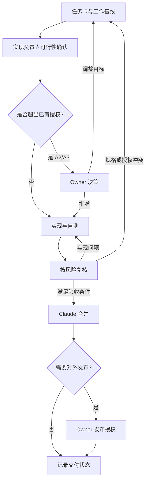

# Atomium 多模型协作章程（试行 v0.1）

> 状态：试行，2026-11-27 生效。观察窗口为接下来 5–10 个真实任务，结束后复盘修订。
> 本章程管理"谁决定什么、什么算完成、分歧怎么收敛"。产品决策与红线以 [`product-spec.md`](../product-spec.md) 为准，仓库约定以根目录 [`AGENTS.md`](../../AGENTS.md) 为准；三者冲突时以 product-spec 红线优先。

## 1. 角色

| 角色 | 担任者 | 职责 | 拍板范围 |
|---|---|---|---|
| **Owner** | 你 | 目标、优先级、预算、红线、授权边界 | A2 / A3 事项、对外发布、撤销或调整任何授权 |
| **技术负责人兼集成人** | Claude | 维护技术基线与 ADR、写任务卡、设计一致性评审、合并 | A1 范围内的技术取舍、任务拆分、合并顺序 |
| **实现负责人** | ChatGPT | 开工前可行性确认、实现、自测、提供目标环境证据、提交偏差申请 | 规格范围内的实现方式（内部结构、局部算法、文件组织） |
| **顾问兼独立评审** | Gemini | 撰写面向 Owner 的汇报、调研重要未知项、核查高风险任务的关键假设 | 可依据**已接受的验收条件**提出阻断意见；不派活、不改优先级 |

说明：

- 角色按**同一项变更**指定，不是永久限制。Claude 可以写原型，但它写的变更就需要别人评审；评审者一旦动手修改，就成为该部分的作者。
- Gemini 直接向 Owner 汇报，无需技术负责人预先审阅；它的异议对 Owner 和相关执行者同时可见。
- 评审结论必须写明评审者实际能访问什么（只看报告 / 读了代码与原始日志 / 在目标环境复验）。

## 2. 授权分级（A0–A3）

> 使用 A 前缀，避免与产品隔离档位 L1/L2/L3 混淆。分级依据是**权限变化、外部副作用、可逆性和影响范围**，不是动作名称。

| 等级 | 范围 | 处理方式 |
|---|---|---|
| **A0 自主执行** | 任务范围内的实现、自测、内部重构、测试产物清理 | 直接推进，记录在 PR / 任务卡 |
| **A1 技术负责人处理** | 已授权目标内的局部设计调整、一般依赖变化、集成协调、偏差申请审批 | Claude 决定并记录理由，无需 Owner 重复批准；Owner 事后可在汇报中看到 |
| **A2 需要 Owner 扩展授权** | 新增权限或外部依赖类别、超预算、超出已批准架构的变更、**`crates/atomium-protocol` 破坏性变更**、交付范围变化 | 先准备方案与影响，Owner 决定前暂停受影响部分，其余工作继续 |
| **A3 Owner 保留** | 需要 `sudo` 的命令、交互式身份确认、系统权限授予、删除账户或目录、真实环境与对外发布操作 | 由 Owner 本人执行，或依据 Owner 明确给出的专项授权 |

补充：

- 使用已授权的受限凭据代理，与读取、展示、转交明文凭据是不同操作；后者不属于任何可申请的等级。
- 是否涉及权限看实际效果，不只看是否出现 `sudo`。
- 提示词中的角色规则只是协作约定；仓库写入、合并、网络访问、凭据使用的边界需要由实际运行环境的权限配置保证。

## 3. 硬性禁止项（不可通过申请升级放行）

1. product-spec §2 全部红线：同供应商自动换号、账号池 / 共用 / 转售订阅、地区与身份伪装、绕过供应商地区限制、`host.exec` 类门户插件。
2. 在日志、事件、快照、命令行参数、测试输出、任务卡、PR、汇报中出现明文凭据（只允许摘要）。
3. 在 RPC 中新增"关闭沙盒"或"任意宿主路径"类参数。开发模式只通过 `DaemonState::with_unsandboxed_dev_mode(true)` 或 `ATOMIUM_DEV_UNSANDBOXED=1` 进入。
4. 新功能依赖 `legacy/` 或 `packages/agent-drivers/src/account-auth/`。
5. 把完整环境变量、凭据或与任务无关的私人数据复制进跨模型交接材料。

## 4. 工作流

### 4.1 开工前可行性确认（实现负责人回答三个问题）

1. 当前环境和工具能否完成？
2. 哪些假设需要先做小实验？
3. 验收条件能否实际验证（包括在哪个环境验证）？

### 4.2 按风险分档评审

| 档位 | 典型任务 | 评审要求 |
|---|---|---|
| **R0 低风险** | 文案、注释、低影响内部调整 | 作者自检 + CI 通过 |
| **R1 一般** | 一般功能、错误修复、局部重构 | 作者自检 + Claude 设计一致性评审 |
| **R2 高风险** | 架构、协议、隔离 / 沙盒、网络出口、凭据、停止机制、外部副作用 | 作者自检 + Claude 设计一致性评审 + Gemini 关键假设核查 + 目标环境证据 |

任务卡上由 Claude 标注档位；实现者或 Gemini 认为档位偏低时可以提出上调。

### 4.3 评审意见分类

- **阻断项**：违反已接受的验收条件、缺少必需的验证、越过授权边界。必须处理后才能合并。
- **改进建议**：不阻断当前交付，可记入后续。
- **新需求**：进入新任务，由 Owner / Claude 按优先级处理；不得算作当前任务未完成。

## 5. 验收规则

1. **作者必须自检**；需要独立评审的变更，不能仅凭作者自评完成验收。
2. **谁提出事实性主张，谁提供来源或验证证据**（标明版本、平台、获取时间、哪些是推断）。Gemini 负责对关键或有争议的主张做独立核查和反例搜索。
3. **交付绑定版本**：评审结论针对具体提交；之后代码、配置或依赖发生变化，应判断哪些结论失效并复核受影响部分。
4. **隔离类任务必须覆盖拒绝行为**：允许路径可用、禁止路径确实被拒、子进程仍受约束、拒绝结果可记录。
5. **状态分开记录**：实现完成 / 目标环境验证通过 / 已合并 / 已发布 是四个不同状态。只在 Linux 或 mock 环境验证的，必须写明"macOS 原生行为未验证"。
6. 失败、跳过、未验证的事实状态不得因为 Owner 批准交付而改写为"通过"；Owner 可以接受**明确说明的**剩余风险。
7. 完整门禁：`pnpm run ci:local`。只改 Rust 时可用 AGENTS.md 中的 Rust 子集。

## 6. 分歧处理

| 分歧类型 | 处理方式 |
|---|---|
| 可验证的技术事实（某接口是否可用、某行为是否发生） | 查原始资料或做一次有上限的最小实验 |
| 已授权范围内的可逆技术取舍 | Claude 裁决，在 ADR 或 PR 中保留异议与理由 |
| 产品目标、预算、交付范围之间的取舍 | 交 Owner 决定 |
| 权限边界变化或重大未解决风险 | 暂停受影响操作，交 Owner 决定 |

- 提交给 Owner 的争议摘要：双方**各自**写明主张、证据、影响、替代方案，不由一方单方面概括。
- 收敛条件：一轮证据交换 + 至多一个有上限的实验；没有新证据就不再继续辩论，按上表归属裁决。
- 已确认的技术基线（如 Rust 核心、CLI 优先、Tauri 桌面端，见 product-spec §1 决策记录）只有在出现**新证据、具体收益和迁移代价**时才重新讨论。

## 7. 交接与事实基线

- **仓库记录是共享工作基线**：目标与决策由有效的规格 / ADR 确定；当前行为由对应版本的代码和运行证据证明。三者冲突时记录差异并处理，不得为了匹配实现而静默降低规格。
- **交接不得依赖未随任务提供的会话记忆**：每次开工先加载本章程、当前任务卡与相关 ADR。
- 文档按需增长，默认只维护三类：
  - 本章程；
  - 任务卡（模板见 [`task-card.md`](task-card.md)），普通任务直接写在 PR 描述里；
  - ADR（`docs/collab/adr/NNNN-标题.md`），只用于影响长期架构或多个任务的决策。

## 8. 并行与写入

- 一项任务只有一个执行负责人。
- 并行写入使用独立分支或 worktree；评审默认只读。
- 共享接口（尤其是协议）的变更需在任务卡中写明依赖关系。
- Claude 是唯一集成人，负责合并顺序；R2 任务需 Gemini 签字后才能合并。

## 9. 面向 Owner 的汇报

由 Gemini 撰写，素材取自任务卡和 PR 状态，固定四段：

1. **需要你决定的事项**（没有就写"无"）
2. 已交付成果及证据位置
3. 当前阻塞与未验证部分
4. 接下来会自主推进的工作

## 10. 试运行评估

观察 5–10 个真实任务（需包含普通 CLI 修复、一般功能增量、至少一项 R2 权限边界任务），只评估四项：

| 指标 | 判断什么 |
|---|---|
| Owner 被要求介入的次数，以及其中有多少其实已有授权 | 授权规则是否清晰 |
| 交接与评审的等待时间 | 流程是否拖慢交付 |
| 独立评审发现的实际问题 | 评审是否产生新增价值 |
| 交付后的返工与遗漏 | 协作是否改善结果 |

不使用报告数量、发现"风险"的数量或三方一致率作为评价指标。复盘结论写入本章程的修订记录。

## 修订记录

| 版本 | 日期 | 变更 |
|---|---|---|
| v0.1 | 2026-11-27 | 初版试行：综合 Claude 原方案与 ChatGPT 审核意见 |
